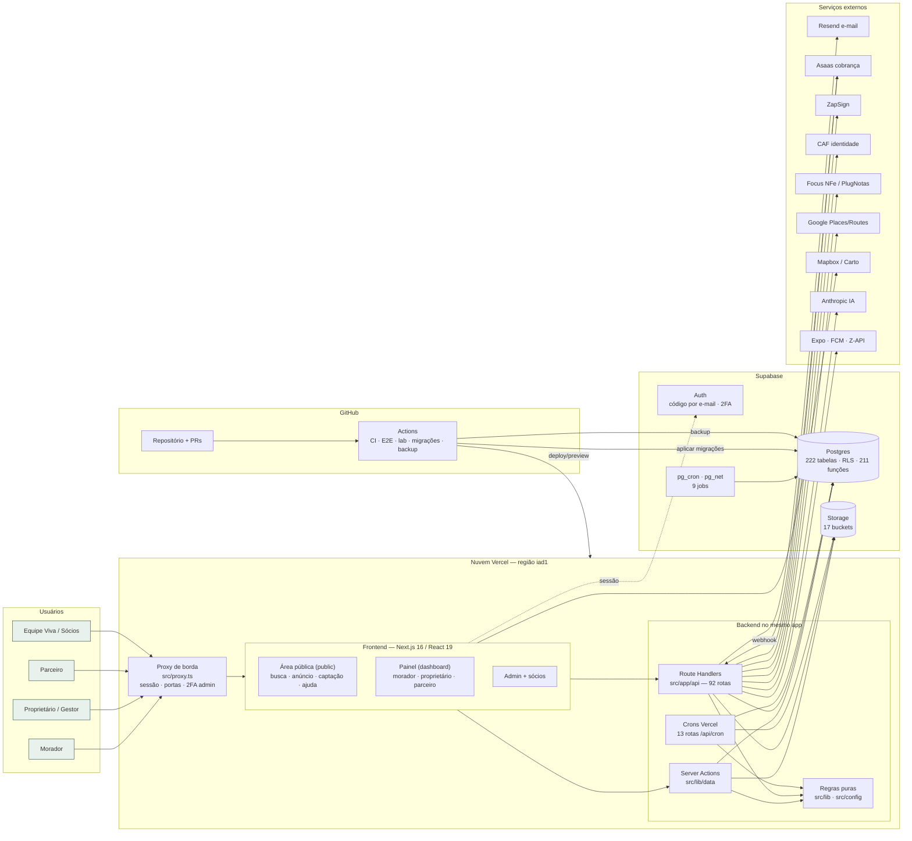

# E867 — Documentação técnica da aplicação Viva Nomads

> Descritivo funcional e hierárquico, com o diagrama geral (frontend, backend, banco e nuvem).
> Tirado do código da `main` (`27dbdf1`, 12/11/2026) e da base Supabase de produção, lida em 13/11/2026 só com consultas de leitura.
> Não é código. Também serve de **mapa do código**: a seção 8 diz onde mora cada coisa.
> Os números marcados com † são conferidos pelo teste `src/lib/e867-mapa-codigo.test.ts`. Se o repositório mudar, o teste falha e este documento precisa ser atualizado.

---

## 1. O que é a aplicação

A Viva Nomads é uma plataforma de **locação mobiliada de média duração, de 30 a 180 dias**. Quatro perfis usam a plataforma:

| Perfil | O que faz na plataforma |
|---|---|
| **Morador** (inquilino) | Busca imóveis, conversa pelo chat da Viva, agenda visita, se candidata, assina o contrato digital, paga direto ao proprietário, avalia e gerencia a estadia. |
| **Proprietário** (e Gestor de carteira, 20+ imóveis) | Qualifica e publica o imóvel, responde candidaturas, gera o contrato, acompanha recebimentos, caução, renovação, saída e avaliações. |
| **Parceiro** (limpeza, mudança, fotógrafo, avaliador/vistoria) | Oferece serviços, recebe pedidos, entrega e é avaliado. |
| **Equipe Viva** (admin e sócios) | Modera, aprova, acompanha os indicadores e o financeiro, e opera as filas (atendimento, verificação, vistoria, qualidade). |

Princípios de desenho que atravessam o código:
- A Viva **não retém valores**: o aluguel e a caução vão direto ao proprietário. A Viva cobra só a taxa de serviço do proprietário.
- Telefone, e-mail e redes sociais **nunca são trocados** entre as partes. Toda a conversa fica no chat da Viva.
- **Chaves de plataforma** ligam e desligam funções sem deploy (seção 6).
- **Fallback de demonstração**: sem a chave de um fornecedor, a integração devolve uma resposta simulada.

---

## 2. Descritivo funcional hierárquico

### 2.1 Área pública (sem login): `src/app/(public)`, 39 páginas †
1. **Descoberta:** a home (`/`), `/buscar` (lista com mapa, filtros facetados e contagens), `/cidades/[cidade]` e `/imoveis-perto-de/[slug]`.
2. **Anúncio:** `/imoveis/[id]`, com galeria, nível e selos, composição do valor mensal, calendário, tempo de deslocamento, avaliações e o caminho para morar.
3. **Institucional e captação:** `/como-funciona`, `/para-proprietarios`, `/empresas`, `/parceiros`, `/avaliadores`, `/seguranca` e `/precos`. Esta última fica suspensa enquanto `PRECOS_VISIVEL` estiver desligada.
4. **Ajuda e conteúdo:** `/ajuda` (central e fale com a Viva), `/guias` e `/guia-fotos`.
5. **Confiança e legal:** `/conferir`, que valida um documento pelo hash, mais `/termos`, `/privacidade` e `/excluir-conta`.
6. **Pedidos de moradia:** `/pedidos`, onde quem procura imóvel publica a necessidade e os proprietários da cidade respondem.

### 2.2 Entrada e conta: `src/app/auth`, 5 páginas e 3 rotas †
- Entrada única por código enviado por e-mail, com senha como alternativa e Google/Apple atrás de chaves.
- Escolha da intenção (morar, anunciar, oferecer serviço) e do papel ativo.
- 2FA obrigatória para o admin (`ADMIN_2FA_OBRIGATORIA`), com códigos de recuperação.

### 2.3 Painel do usuário: `src/app/(dashboard)/dashboard`
Organizado por papel. O menu vem de `src/config/menu-por-papel.ts` e `src/config/rotas-app.ts`.

**Morador**
1. Favoritos, buscas salvas e alertas de busca.
2. Candidaturas e propostas, e depois o fechamento.
3. Contrato: assinatura digital por código, aditivos e ficha-resumo.
4. Estadia: check-in, instruções de chegada, convidados (ocupantes), manutenção (chamados) e renovação em blocos.
5. Pagamentos direto ao proprietário, recibos e reembolsos.
6. Saída: devolução da caução com descontos itemizados e prazos, e avaliação da estadia.

**Proprietário**
1. Cadastro do imóvel, em etapas, com autosave. A ajuda "Publicamos para você" fica no mesmo ponto.
2. Qualificação (`/qualificar`): elegibilidade + pontuação, nível (Essencial e acima) por elo mais fraco, prova por foto tirada na hora, medição de internet e ruído.
3. Publicação, que exige o documento do imóvel aprovado, e calendário com importação de iCal.
4. Leads, candidaturas, visitas (presenciais e por vídeo), triagem e vínculo profissional do candidato.
5. Fechamento: proposta, contrato, caução e cobrança da taxa (faixas 12/10/8/6 e Gestor 4%).
6. Carteira, ganhos, recibos, informe para o carnê-leão, tributação e simulador de rentabilidade.
7. Parceiros do imóvel (limpeza e vistoria automáticas), conferência e laudos.

**Parceiro**
1. Perfil, serviços, galeria e agenda.
2. Pedidos e solicitações, entregas com fotos, ganhos e avaliações recebidas.

### 2.4 Área interna da equipe: `src/app/(dashboard)/admin` e a área dos sócios
- **Operação:** usuários, imóveis, documentos, verificação, moderação (de fotos de perfil e ofensas), qualidade, pendências, conforto, vistorias e avaliadores, fotógrafos, solicitações, ajuda à publicação, cidades e destinos.
- **Relacionamento:** atendimento (chamados com macros e prazos) e e-mails de teste.
- **Gestão:** visão geral, indicadores, funil, retenção, financeiro, marketing, premissas, sistema (chaves) e agentes.
- **Sócios e investidor:** `/acesso-socios`, `/modelodenegocio`, `/roi`, `/simulacao` e `/tributario`, atrás de um código de acesso (proxy).

### 2.5 Rotinas automáticas (backend)
Seis rotinas sem tela: e-mails transacionais e proativos, notificações push, cobrança mensal, prazos (caução, conforto, pré-aceitação de 72 h), lembretes de check-in, resumo semanal, importação de calendário, retenção e limpeza de dados (LGPD), backup e o laboratório de testes. Os horários estão na seção 5.

---

## 3. Arquitetura técnica em camadas

| Camada | Tecnologia | Onde está |
|---|---|---|
| Interface | Next.js 16 (App Router) + React 19 + TypeScript + Tailwind v4. Componentes de servidor por padrão, cliente onde há interação. | `src/app`, `src/components` |
| Borda (proxy) | `src/proxy.ts`, o middleware do Next 16. Cuida da sessão Supabase, das portas da área interna e dos sócios, do portão da 2FA do admin, do redirecionamento de conta no servidor, do modo app e da marcação de tráfego de teste. | `src/proxy.ts` |
| Ações e API | Server Actions (`"use server"`) e Route Handlers em `src/app/api`, com 92 rotas †: autenticação, upload, e-mail, webhooks, crons, painel, admin e QA. | `src/lib/data/*-actions.ts`, `src/app/api/**/route.ts` |
| Regras puras | Funções sem rede, testadas com `node --test`: cobrança, caução, nível, ranking, busca, prazos, textos regulados. | `src/lib/**`, `src/config/**` |
| Acesso a dados | Cliente Supabase do servidor (sessão do usuário, RLS) e cliente de serviço (`SUPABASE_SERVICE_ROLE_KEY`), este só em rotinas e no admin. | `src/lib/supabase`, `src/lib/data` |
| Banco | Postgres (Supabase), RLS em quase todas as tabelas, funções SQL e triggers, `pg_cron` e `pg_net`. | `supabase/migrations` |
| Arquivos | Supabase Storage, 17 buckets: 2 públicos (`property-photos` e `parceiros`) e os demais privados, com URL assinada. | seção 4.3 |
| Hospedagem | Vercel, região `iad1`, com o projeto ligado ao GitHub: cada PR ganha um preview e a `main` vai para produção. | `vercel.json` |

---

## 4. Banco de dados (Supabase, produção)

### 4.1 Números (lidos em 13/11/2026)
- 222 tabelas no schema `public`, 221 com RLS. A exceção é `_bkp_0176_contratos_encerrados`, uma cópia de backup de migração que nenhuma tela lê.
- 316 políticas RLS, 211 funções, 92 triggers e 5 views.
- 290 migrações registradas em `supabase_migrations.schema_migrations`; a última é `20261112000342`. O repositório tem 335 arquivos `.sql` † em `supabase/migrations`. A diferença vem de arquivos auxiliares e de migrações numeradas que foram reunidas ao aplicar.
- Extensões: `pg_cron`, `pg_net`, `pgcrypto`, `uuid-ossp`, `btree_gist` (impede reservas sobrepostas), `pg_stat_statements` e `supabase_vault`.

### 4.2 Domínios das tabelas (hierarquia funcional)
1. **Identidade e conta:** `profiles`, `mfa_*`, `telefone_verificacao`, `tenant_verifications`, `verificacao_revisoes`, `vinculo_profissional`, `perfil_redes`, `confianca_linkedin`, `exclusao_conta_pedidos` e `account_type_audit`.
2. **Imóvel:** `properties`, `property_photos`, `property_amenities`, `property_blocks`, `property_proximities`, `property_workspaces`, `property_ownership_checks`, `imovel_*` (estrutura, extras, nível, ruído, marcas, parceiros, instruções de chegada), `nivel_itens`, `internet_medicoes`, `qualification_checklists`, `conforto_*`, `fotos_anuncio_hash`, `preco_justo_airbnb` e `quedas_preco`.
3. **Descoberta e demanda:** `favorites`, `buscas_salvas`, `alertas_busca_envios`, `destinos*`, `tempos_deslocamento`, `proximidades_*`, `pedidos_moradia`, `respostas_pedido`, `interesse_*` e `ranking_sombra`.
4. **Negociação:** `leads`, `messages`, `mensagens_*`, `conversa_aberturas`, `visitas_video`, `propostas`, `proposta_versoes` e `triagem_vinculos`.
5. **Contrato e estadia:** `contratos` (com `contracts`, a tabela legada), `contrato_*` (assinaturas, códigos, aditivos, blocos, eventos, ocupantes, ficha-resumo, encerramento), `contratos_checkin`, `locacoes`, `estadia_convidados`, `modelos_contrato` e `garantias`.
6. **Dinheiro (sem custódia):** `caucao_*`, `recebimentos`, `recebimento_pix`, `pagamentos_bloco`, `cobranca_mensal_parcelas`, `cobrancas_fechamento`, `faixas_comissao`, `faixa_dono`, `comissao_fixada_admin`, `config_cobranca`, `asaas_eventos`, `subscriptions`, `invoices`, `transactions` e `utility_extra_charges`.
7. **Documentos:** `documentos_registro` (o número único e o hash usados por `/conferir`), `document_counters`, `documents`, `documentos_fiscais*`, `documentos_inquilino` e `documentos_falhas`.
8. **Vistoria, conferência e manutenção:** `vistoria_*`, `vistorias`, `conferencia*`, `service_orders*` e `proprietario_strikes`.
9. **Parceiros e serviços:** `parceiros*`, `parceiro_*`, `servicos_*`, `fotografo*` e `config_parceria`.
10. **Avaliações e moderação:** `avaliacoes`, `avaliacao_*`, `parceiro_avaliacoes`, `denuncias_anuncio`, `moderacao_*` e `fotos_perfil_revisao`.
11. **Comunicação:** `eventos` (a matriz de notificações), `emails_proativos`, `emails_teste`, `push_*`, `automacoes_envios`, `avisos*`, `chamados*` e `respostas_rapidas`.
12. **Operação e governança:** `plataforma_chaves` e `chaves_plataforma`, `cidades_liberadas`, `limites_uso`, `lab_execucoes`, `qa_entradas`, `backups_execucoes`, `eliminacoes_*` (retenção LGPD), `agentes*`, `ia_chamadas`, `ai_generations`, `caixa_socios`, `gastos_marketing` e `ativacoes`.

### 4.3 Buckets do Storage
- **Públicos:** `property-photos` e `parceiros`.
- **Privados:** `anuncio-videos`, `avaliacao-imovel`, `avaliadores`, `avatars`, `caixa-socios`, `chamados`, `conferencia`, `documentos`, `inquilino-docs`, `mensagens-anexos`, `parceiro-entregas`, `pets-fotos`, `property-docs`, `triagem-vinculos` e `vistoria-fotos`.

---

## 5. Rotinas agendadas

**Vercel Cron**, 13 rotas † em `vercel.json`. Todas chamam `src/app/api/cron/*` com `CRON_SECRET`. Horários em UTC:

| Rota | Quando | Função |
|---|---|---|
| `pre-aceitacao` | de hora em hora | prazo de 72 h da pré-aceitação |
| `resumo-pedidos` | 11:00 | resumo dos pedidos de moradia para os donos |
| `atendimento` | 10:00 | lembretes e prazos do atendimento |
| `checkin-lembretes` | 12:00 | lembretes de check-in |
| `automacoes` | 13:00 | e-mails e sugestões automáticas (sob `AUTOMACOES_ATIVO`) |
| `prazos-conforto` | 14:00 | prazos de solução das pendências de conforto |
| `cobranca-mensal` | 14:10 | parcelas da cobrança mensal |
| `vistoria` | 15:00 | designações e prazos de vistoria |
| `caucao-prazos` | 15:30 | prazos de devolução da caução |
| `linkedin` | 16:00 | confiança via LinkedIn |
| `calendario` | 17:00 | sincronização de calendários |
| `mensagens-programadas` | 18:00 | mensagens agendadas |
| `avisos-daniel` | 22:00 | resumo diário para o Daniel |

**pg_cron**, 9 jobs no banco:

| Job | Quando (UTC) |
|---|---|
| `atendimento-prazos` | a cada 15 min |
| `prazos-conforto` | a cada 15 min |
| `mensagens-programadas` | de hora em hora, no minuto 7 |
| `vistoria` | de hora em hora, no minuto 7 |
| `calendario-importar` | de hora em hora, no minuto 23 |
| `avancar-ciclo-blocos` | 06:00 |
| `expira-pedidos-moradia` | 06:05 |
| `e293-limpeza-retencao` | 04:17 |
| `limpar-eventos-antigos` | 04:30, no dia 1 de cada mês |

**GitHub Actions** (`.github/workflows`, 12 fluxos †): CI (lint, tipos, testes unitários e gates), E2E (Playwright), Lab crítico, Laboratório noturno, Aplicar migrações em produção (no merge da `main`), Backup noturno, Ensaio do backup, Teste de restauração, Aplicar e-mails de conta no Supabase, o lembrete correspondente, Linhas de base visuais e Admin observador da QA.

---

## 6. Integrações externas e chaves

| Fornecedor | Para quê | Onde |
|---|---|---|
| Supabase | Auth, Postgres, Storage, pg_cron | `src/lib/supabase` |
| Resend | e-mail transacional e proativo | `src/lib/notifications` |
| Asaas | cobrança da taxa (PIX, boleto, cartão) + webhook | `src/lib/payments`, `/api/webhooks/asaas` |
| ZapSign | assinatura de contrato (alternativa à assinatura por código) | `src/lib/integrations/zapsign.ts` |
| CAF (Combate à Fraude) | verificação de identidade do morador | `src/lib/integrations/caf.ts` |
| Focus NFe / PlugNotas | NFS-e (atrás de `NFSE_ATIVA`) | `src/lib/integrations/nfse.ts` |
| Google (Places, Routes, Geocoding) | endereço, proximidades, tempo de deslocamento | `src/lib/integrations`, `src/lib/rotas` |
| Mapbox (Carto como fundo alternativo) | mapas da busca e do anúncio | `src/components/property-map.tsx`, `search-map.tsx` |
| ViaCEP / BrasilAPI | CEP e bairro no cadastro do imóvel | `src/lib/cep`, `dashboard/imoveis/novo` |
| Cloudflare (Turnstile, speedtest) | antirrobô nos formulários; medição de internet | `src/components/seguranca/captcha.tsx`, `src/lib/internet-motor.ts` |
| Anthropic | atendimento por IA, detecção nas fotos, agentes internos | `src/lib/ai`, `src/lib/atendimento`, `src/lib/agentes` |
| LinkedIn | sinal de confiança do perfil | `src/lib/linkedin` |
| Expo / FCM | push no app | `src/lib/notifications/push.ts`, `expo-push.ts` |
| Z-API | WhatsApp (avisos) | `src/lib/notifications/whatsapp.ts` |
| Vercel Analytics | métricas de página | `src/components/analytics/analytics-vercel.tsx` |

**Chaves de comportamento.** Variáveis `NEXT_PUBLIC_*_ATIVA/ATIVO` e chaves de servidor (`AUTOMACOES_ATIVO`, `PAINEL_SESSAO_SERVIDOR`, `RESUMO_SEMANAL_ATIVO` etc.) ligam funções sem mudar código. A tabela `plataforma_chaves` guarda as que mudam em tempo de execução (por exemplo, o ranking em `src/lib/ranking/chave.ts`). As chaves de ambiente são conferidas em `src/config/chaves-ambiente.ts`.

---

## 7. Diagrama geral



Versão em texto, para quem lê sem renderizar:

```
 Morador · Proprietário · Parceiro · Equipe
                    │ HTTPS
        ┌───────────▼────────────── Vercel (iad1) ───────────────────────┐
        │  proxy.ts → páginas (public | dashboard | admin)                │
        │            → Server Actions / API (92) / Crons (13)             │
        │            → regras puras (src/lib, src/config)                 │
        └───────┬───────────────┬──────────────────────┬─────────────────┘
                │ SQL + RLS     │ arquivos             │ HTTP
        ┌───────▼──────┐ ┌──────▼──────┐   ┌───────────▼──────────────────┐
        │ Postgres     │ │ Storage     │   │ Resend · Asaas · ZapSign ·   │
        │ 222 tabelas  │ │ 17 buckets  │   │ CAF · NFS-e · Google · Mapbox│
        │ pg_cron (9)  │ └─────────────┘   │ Anthropic · Expo/FCM · Z-API │
        └──────▲───────┘                   └──────────────────────────────┘
               │ migrações, backup
        GitHub Actions (CI · E2E · lab · aplicar migrações · backup)
```

---

## 8. Mapa do código: onde mora cada coisa

| Quero mexer em… | Vá para |
|---|---|
| uma página pública | `src/app/(public)/<rota>/page.tsx` |
| uma tela do painel | `src/app/(dashboard)/dashboard/<área>/` |
| uma tela do admin | `src/app/(dashboard)/admin/<área>/` |
| uma ação que grava no banco | `src/lib/data/*-actions.ts` (Server Actions) |
| uma rota HTTP, webhook ou cron | `src/app/api/<grupo>/route.ts` (`api/cron/*`, `api/webhooks/asaas`) |
| uma regra de negócio (sem rede) | `src/lib/<domínio>/` (cobranca, caucao, niveis, busca, contratos, estadia, vistoria…) |
| um texto regulado (contato, caução, taxas) | `src/config/textos-regulados.ts` + o gate `src/lib/frases-proibidas.ts` |
| o menu ou as rotas por papel | `src/config/menu-por-papel.ts`, `src/config/rotas-app.ts` |
| uma chave de comportamento | `src/config/chaves-ambiente.ts` |
| um e-mail ou aviso | `src/lib/notifications/` + `src/config/matriz-notificacoes.ts` |
| sessão, portas, 2FA | `src/proxy.ts`, `src/lib/admin/mfa.ts`, `src/lib/socios/access.ts` |
| o esquema do banco | `supabase/migrations/NNNN_*.sql` + `supabase/producao/aplicar-NNNN.sql` (ver CONTRIBUTING.md) |
| testes | `node --test` ao lado do código (`*.test.ts`); E2E em `tests/e2e/specs`; lab em `tests/laboratorio` |

---

## 9. Fluxo de entrega

1. Cada mudança abre um PR. O CI roda lint, `tsc`, os testes unitários e os gates (consistência, frases proibidas, estilo).
2. A Vercel gera um preview por PR. O lab-crítico e o E2E rodam os fluxos críticos.
3. O merge na `main`, feito pelo Daniel, é a aprovação: a Vercel publica em produção e a Action "Aplicar migrações em produção" aplica o que ainda não está em `schema_migrations`.
4. Rede de segurança: backup noturno, ensaio do backup e teste de restauração.
